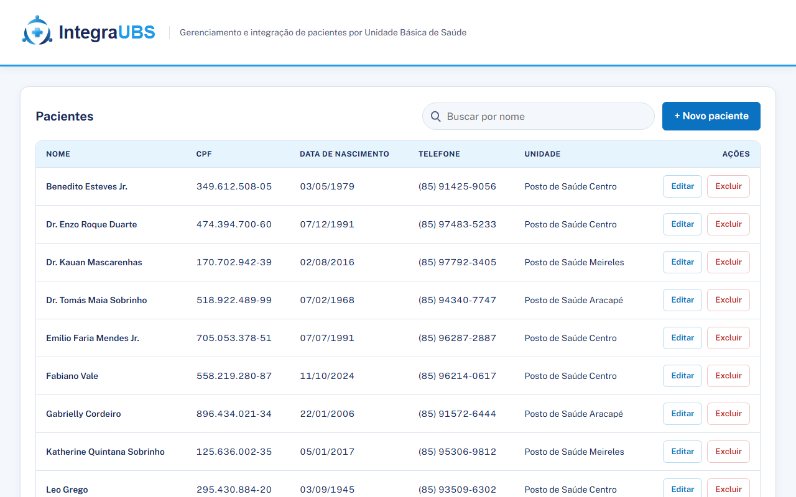
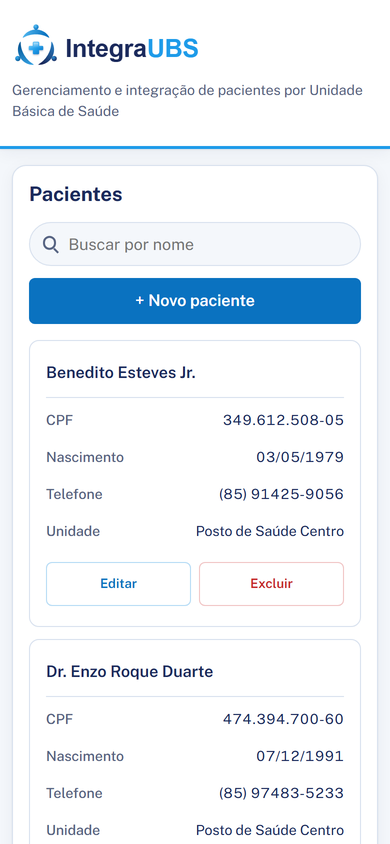
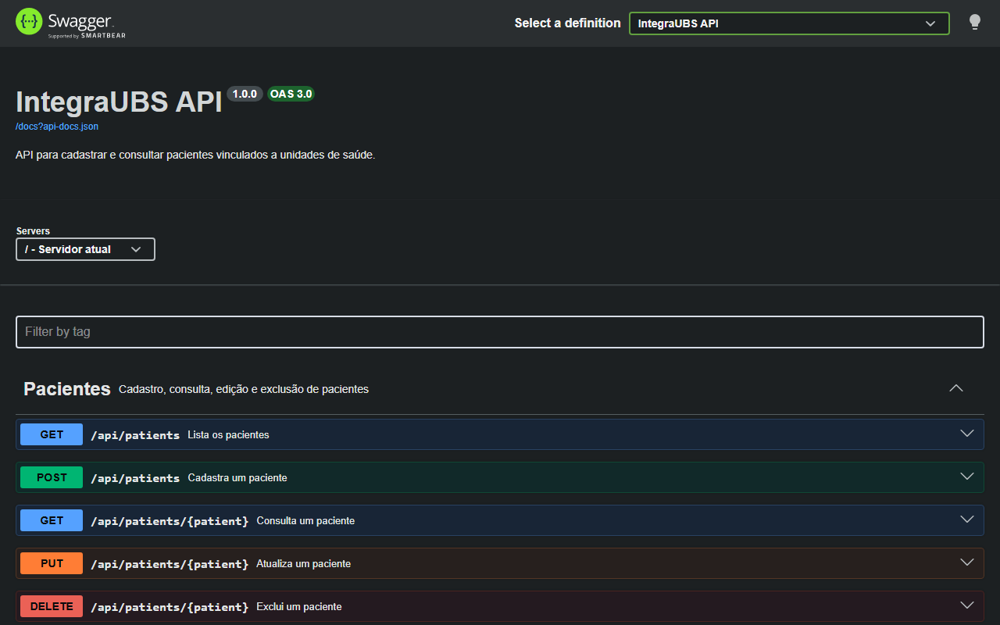

# IntegraUBS · Cadastro de Pacientes

[](https://github.com/Pedro-HS-Rodrigues/IntegraUBS-Desafio-ConectaSUS/actions/workflows/ci.yml)

Aplicação web para **cadastrar e consultar pacientes vinculados a unidades de saúde**, desenvolvida como desafio técnico para a vaga de Programador(a) PHP Júnior.


## Sumário

- [Funcionalidades](#funcionalidades)
- [Stack](#stack)
- [Pré-requisitos](#pré-requisitos)
- [Instalação](#instalação)
- [Como usar](#como-usar)
- [API](#api)
- [Banco de dados e SQL](#banco-de-dados-e-sql)
- [Arquitetura e decisões técnicas](#arquitetura-e-decisões-técnicas)
- [Testes e qualidade](#testes-e-qualidade)
- [O que está funcionando](#o-que-está-funcionando)
- [O que ficou incompleto e próximos passos](#o-que-ficou-incompleto-e-próximos-passos)
- [Capturas de tela](#capturas-de-tela)
- [Créditos](#créditos)

## Funcionalidades

- Listagem de pacientes com **paginação** (10 por página) e **busca por nome** com debounce de 300 ms.
- **Cadastro e edição** no mesmo formulário, com máscaras de CPF e telefone e **erros de validação exibidos abaixo de cada campo**.
- **Exclusão com confirmação**, mostrando o nome do paciente.
- Estados de carregamento, lista vazia e erro, com botão "Tentar novamente".
- Layout responsivo: no celular a tabela vira uma lista de cartões.
- **API REST** documentada com **Swagger UI**.

## Stack

| Camada              | Tecnologia                                   |
| ------------------- | -------------------------------------------- |
| Backend             | PHP 8.4 · Laravel 13                         |
| Banco               | MySQL 8.4 LTS                                |
| Frontend            | HTML, CSS e JavaScript                       |
| Documentação da API | L5-Swagger (Swagger UI / OpenAPI)            |
| Testes              | Pest 5                                       |
| Estilo de código    | Laravel Pint                                 |
| CI                  | GitHub Actions (Pint + testes com MySQL 8.4) |

## Pré-requisitos

- PHP **8.4** ou superior (com as extensões `pdo_mysql`, `mbstring` e `openssl`; para rodar os testes localmente, também `pdo_sqlite`)
- Composer **2**
- MySQL **8.4** rodando

## Instalação

**1. Clone o repositório e instale as dependências**

```bash
git clone git@github.com:Pedro-HS-Rodrigues/IntegraUBS-Desafio-ConectaSUS.git
cd IntegraUBS-Desafio-ConectaSUS
composer install
```

**2. Crie o arquivo de ambiente e gere a chave**

```powershell
copy .env.example .env
php artisan key:generate
```

No Linux ou macOS, use `cp .env.example .env`.

**3. Configure o acesso ao banco**

Abra o `.env` e preencha a senha do seu MySQL (e o usuário, se não for `root`):

```env
DB_DATABASE=integraubs
DB_USERNAME=root
DB_PASSWORD=sua_senha
```

O banco `integraubs` **não precisa ser criado à mão**: o Laravel cria quando as migrations rodam (o usuário do MySQL precisa ter permissão de criar bancos, como o `root`).

**4. Crie o banco, as tabelas e os dados de exemplo**

```bash
php artisan migrate:fresh --seed
```

Isso cria o banco `integraubs` (se ainda não existir), as tabelas, 4 unidades de saúde de Fortaleza e 20 pacientes de exemplo (inclusive uma "Maria", para testar a busca).

**5. Suba o servidor**

```bash
php artisan serve
```

> **Atalho:** se o seu MySQL local usa o usuário `root` sem senha, o comando `composer setup` faz os passos 1, 2 e 4 de uma vez.

## Como usar

| O quê                            | Endereço                                  |
| -------------------------------- | ----------------------------------------- |
| Sistema                          | <http://localhost:8000>                   |
| Documentação da API (Swagger UI) | <http://localhost:8000/api/documentation> |
| API                              | <http://localhost:8000/api>               |

Na documentação, cada endpoint tem o botão **Try it out**, que chama a API real.

## API

Todas as respostas são JSON. Envie sempre `Accept: application/json`.

| Método   | Rota                 | Descrição                                    | Respostas     |
| -------- | -------------------- | -------------------------------------------- | ------------- |
| `GET`    | `/api/patients`      | Lista paginada. Aceita `?search=` e `?page=` | 200           |
| `POST`   | `/api/patients`      | Cadastra um paciente                         | 201, 422      |
| `GET`    | `/api/patients/{id}` | Consulta um paciente                         | 200, 404      |
| `PUT`    | `/api/patients/{id}` | Atualiza um paciente                         | 200, 404, 422 |
| `DELETE` | `/api/patients/{id}` | Exclui um paciente                           | 200, 404      |
| `GET`    | `/api/health-units`  | Lista as unidades de saúde, por nome         | 200           |

### Exemplo: cadastrar um paciente

```bash
curl -X POST http://localhost:8000/api/patients \
  -H "Accept: application/json" -H "Content-Type: application/json" \
  -d '{
    "name": "Maria da Silva",
    "cpf": "529.982.247-25",
    "birth_date": "1985-03-10",
    "phone": "(85) 98888-7777",
    "health_unit_id": 1
  }'
```

Resposta `201`:

```json
{
    "data": {
        "id": 21,
        "name": "Maria da Silva",
        "cpf": "52998224725",
        "birth_date": "1985-03-10",
        "phone": "85988887777",
        "health_unit_id": 1,
        "health_unit": { "id": 1, "name": "Posto de Saúde Centro" }
    },
    "message": "Paciente cadastrado com sucesso."
}
```

Erro de validação (`422`):

```json
{
    "message": "O campo nome é obrigatório. (and 1 more error)",
    "errors": {
        "name": ["O campo nome é obrigatório."],
        "cpf": ["O CPF informado é inválido."]
    }
}
```

### Regras de validação

| Campo            | Regra                                                                                                                |
| ---------------- | -------------------------------------------------------------------------------------------------------------------- |
| `name`           | obrigatório, até 255 caracteres                                                                                      |
| `cpf`            | obrigatório, **CPF válido** (dígitos verificadores), único. Aceita com ou sem máscara; a API guarda só os 11 dígitos |
| `birth_date`     | obrigatória, data válida e **não futura**                                                                            |
| `phone`          | opcional, até 20 caracteres. Guarda só os dígitos                                                                    |
| `health_unit_id` | obrigatório, precisa existir                                                                                         |

As mensagens de erro e de sucesso vêm em português, de `lang/pt_BR/`.

## Banco de dados e SQL

```
health_units 1 ──── N patients
```

| Tabela         | Colunas                                                                                                                               |
| -------------- | ------------------------------------------------------------------------------------------------------------------------------------- |
| `health_units` | `id`, `name`, `city`, `created_at`, `updated_at`                                                                                      |
| `patients`     | `id`, `name` (índice), `cpf` (`CHAR(11)`, único), `birth_date`, `phone` (opcional), `health_unit_id` (FK), `created_at`, `updated_at` |

A tabela é criada pelas **migrations**. O arquivo [`sql/schema_v1.0.sql`](sql/schema_v1.0.sql) traz o mesmo esquema em SQL puro, para quem preferir criar à mão.

As consultas pedidas no desafio estão em [`sql/consultas.sql`](sql/consultas.sql):

1. **`INNER JOIN`**: pacientes com o nome da unidade.
2. **`LEFT JOIN` + `GROUP BY` + `COUNT(p.id)`**: total de pacientes por unidade, **incluindo unidades sem pacientes** (o `COUNT(p.id)` ignora os `NULL` e dá 0; um `COUNT(*)` contaria 1).
3. **`LIKE`**: pacientes cujo nome contém um termo.

Para rodar no terminal:

```bash
mysql -u root -p integraubs < sql/consultas.sql
```

## Arquitetura e decisões técnicas

Fluxo de uma requisição:

```
Navegador (index.html + js/)
  → routes/api.php
  → Form Request (validação, 422 automático)
  → PatientController (só HTTP)
  → PatientService (lógica + Eloquent)
  → Model Patient / HealthUnit
  → MySQL
  ← PatientResource (JSON + message)
```

Decisões:

- **Controller → Service → Eloquent.** O controller só trata HTTP. O `PatientService` recebe arrays já validados e devolve models; ele nunca conhece `Request` nem `Response`.
- **Sem Repository e sem Observers.** O Eloquent já é a abstração do banco, e nenhuma lógica roda escondida.
- **`HealthUnitController` sem service.** É só uma listagem, e criar um service seria uma camada sem nada dentro.
- **`restrictOnDelete`** na chave estrangeira: uma unidade com pacientes não pode ser apagada, e os pacientes nunca somem em cascata.
- **CPF como `CHAR(11)` único**, só com dígitos. A máscara é visual. O `unique` do banco garante a regra mesmo se a validação falhar, e o `ignore()` no update permite manter o próprio CPF.
- **Validação em Form Requests**, com regra própria (`App\Rules\Cpf`) para os dígitos verificadores.
- **Mensagens em `lang/pt_BR/`**, nunca escritas no controller nem no JavaScript.
- **Segurança da busca:** o termo vai por _binding_ (sem concatenar SQL), e `%`, `_` e o caractere de escape são tratados como texto comum.
- **Sem N+1:** a unidade é carregada com `with('healthUnit')`, e `Model::shouldBeStrict()` lança erro em lazy loading, atributo inexistente e atributo não liberado, fora de produção.
- **Erro 404 padronizado** com mensagem em português para qualquer rota `api/*` não encontrada.
- **Frontend sem build**, dividido por responsabilidade:

```
public/
├── index.html
├── css/        base.css · layout.css · components.css · pages/
├── js/
│   ├── main.js        carrega o módulo da página pelo data-page
│   ├── services/      http.js (fetch) · patientService.js · healthUnitService.js
│   ├── components/    tabela, formulário, busca, paginação, mensagens, diálogos
│   ├── pages/         patients.js · patients/list.js · patients/actions.js
│   └── utils/         formatters.js · debounce.js
└── assets/     images/ · vendor/ (Bootstrap e fonte locais) · readme/
```

- **Sem `innerHTML` com dados da API:** o HTML é montado com `createElement` e `textContent`, o que evita XSS.
- **Documentação da API no código:** os atributos do Swagger ficam em classes separadas (`app/Docs/`), sem sujar os controllers.
- **CI:** o GitHub Actions roda o Pint e os testes contra um MySQL 8.4 de verdade, o mesmo banco da aplicação.

## Testes e qualidade

```bash
composer test     # roda os testes (Pest)
composer lint     # confere o estilo (Pint), sem alterar nada
composer format   # corrige o estilo
```

São **34 testes** com 108 asserções, cobrindo:

- cadastro, edição, exclusão e consulta de pacientes, com os códigos 200, 201, 404 e 422;
- CPF duplicado, CPF de outro paciente na edição, CPF com dígitos verificadores inválidos e CPF com máscara;
- data de nascimento futura e unidade inexistente;
- paginação, ordenação e busca parcial (inclusive com `%`, `_` e `!`);
- listagem de unidades de saúde;
- a regra `Cpf` isolada e a abertura da documentação do Swagger.

Localmente os testes usam SQLite em memória, então **não tocam no seu banco**. No CI eles rodam em MySQL.

## O que está funcionando

- Cadastro, listagem, busca, edição e exclusão de pacientes, pela interface e pela API.
- Validação no backend (com mensagens em português) e erros por campo no formulário.
- Paginação, ordenação por nome e busca segura.
- Consultas SQL com `INNER JOIN`, `LEFT JOIN` + `GROUP BY` e `LIKE`.
- Documentação interativa (Swagger UI) e CI verde.


## Capturas de tela

| Lista                                                 | Celular                                                 | Documentação da API                             |
| ----------------------------------------------------- | ------------------------------------------------------- | ----------------------------------------------- |
|  |  |  |
